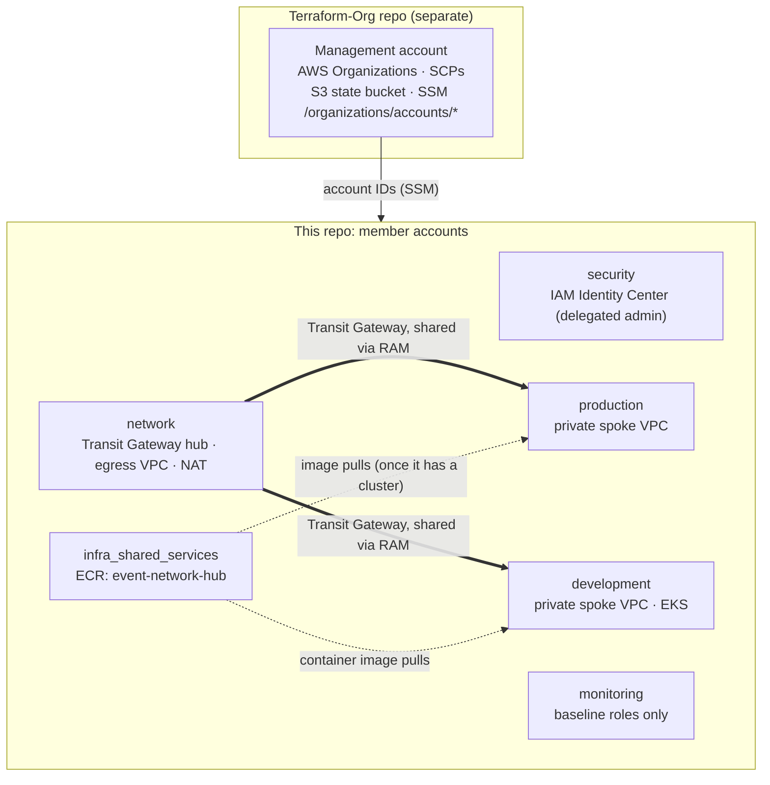
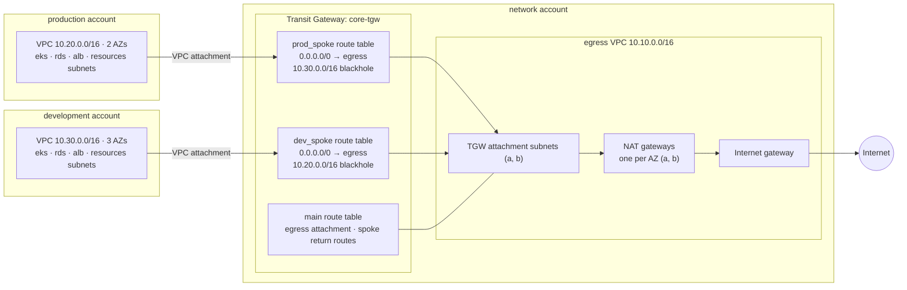
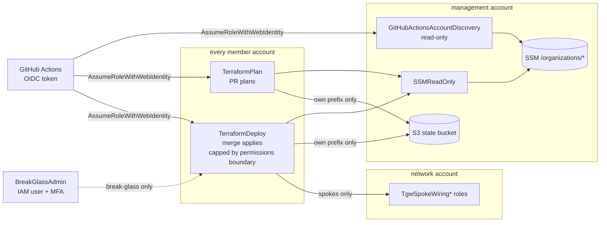
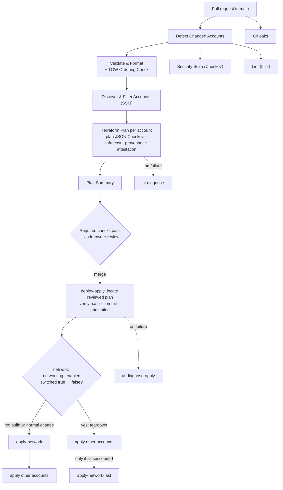
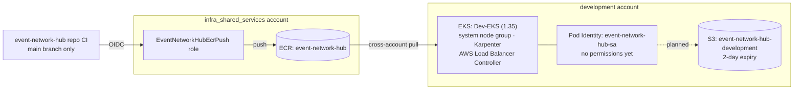

# 🏗️ Multi-Account AWS Infrastructure with Terraform

> Terraform for the six member accounts of a multi-account AWS Organization: delegated SSO, a hub-and-spoke Transit Gateway network with centralised egress, per-account GitHub OIDC deploy roles, and a reviewed-plan CI/CD pipeline.


---

## 📋 Table of Contents

- [Overview](#-overview)
- [Architecture](#-architecture)
  - [Accounts](#accounts)
  - [Network](#network)
  - [Identity and CI access](#identity-and-ci-access)
  - [CI/CD flow](#cicd-flow)
  - [Development application platform](#development-application-platform)
- [Account Structure](#-account-structure)
- [Project Structure](#-project-structure)
- [Prerequisites](#-prerequisites)
- [Setup Instructions](#-setup-instructions)
- [Deployment Guide](#-deployment-guide)
- [State Management](#-state-management)
- [CI/CD Pipeline](#-cicd-pipeline)
- [AI-Assisted CI Failure Diagnosis](#-ai-assisted-ci-failure-diagnosis)
- [Break-Glass Bootstrap](#-break-glass-bootstrap)
- [Teardown](#-teardown)
- [Security Best Practices](#-security-best-practices)
- [Troubleshooting](#-troubleshooting)
- [Contributing](#-contributing)
- [License](#-license)

---

## 🎯 Overview

This repository contains Terraform for the **six member accounts** of a multi-account AWS Organization. The management account, AWS Organizations, the org-wide SCPs and the S3 state bucket live in the companion [Terraform-Org](https://github.com/BernardoJose90/Terraform-Org) repo, which this repo depends on for account IDs (via SSM) and the OIDC trust foundation.

- ✅ **No long-lived AWS credentials in CI.** Every account is reached via GitHub OIDC; no workflow holds an IAM access key. The one exception anywhere in the estate is `BreakGlassAdmin`, a single MFA-protected IAM user whose key is held out-of-band, for one AWS limitation OIDC can't cover (see [Break-Glass Bootstrap](#-break-glass-bootstrap)).
- ✅ **Delegated identity management.** IAM Identity Center (SSO) is administered from the `security` account, AWS's recommended delegated-admin pattern, not from the management account.
- ✅ **Scoped deploy roles per account.** A shared `github-oidc-roles` module gives every account its own `TerraformPlan` (PRs) and `TerraformDeploy` (merges) roles, each capped by a per-account permissions boundary.
- ✅ **Hub-and-spoke networking with centralised egress.** `network` owns the Transit Gateway, the egress VPC and the NAT gateways; `production` and `development` are private spokes with no internet gateway or NAT of their own.
- ✅ **Reviewed plans only.** A merge applies the exact plan file reviewed on the PR, verified by hash, commit stamp and build-provenance attestation.
- ✅ **Order-aware CI.** The pipeline applies `network` first when building and last when tearing down, and blocks PRs that would apply in an unsafe order.
- ✅ **AI-assisted CI failure triage.** A read-only Claude agent explains failed plans and applies on the PR. It's advisory only and never blocks or changes anything (see [AI-Assisted CI Failure Diagnosis](#-ai-assisted-ci-failure-diagnosis)).

### ✨ Key Features

| Feature | Description |
|---------|-------------|
| 🔐 **Delegated SSO** | Users, groups and permission sets managed from the `security` account |
| 🔑 **Least privilege** | Environment-scoped OIDC trust, per-account permissions boundaries, MFA-gated break-glass |
| 🌐 **Centralised egress** | One egress VPC with one NAT gateway per AZ, shared by both spokes over the Transit Gateway |
| 🧱 **Spoke isolation** | Separate TGW route tables per spoke, with a blackhole route for the other spoke's CIDR |
| 🗂️ **State isolation** | Each account's roles can only touch their own prefix in the shared state bucket |
| 🛡️ **CI guardrails** | Checkov, tflint, gitleaks, TGW ordering check, code-owner review, approval-gated environments |
| 💸 **Cost pausing** | `networking_enabled` / `tgw_attachment_enabled` / `eks_enabled` flags remove billable resources through a normal PR |
| 🤖 **AI CI triage** | Read-only LLM agent diagnoses failed plans and applies from the logs and the repo source |

---

## 🏛 Architecture

The diagrams below are [Mermaid](https://docs.github.com/en/get-started/writing-on-github/working-with-advanced-formatting/creating-diagrams), so they render on GitHub and are reviewed in PRs like any other code. Update them in the same PR as the change they describe. Account IDs are deliberately left out because this repo is public.

### Accounts



`security` assigns SSO access to all six accounts. No account reads another account's Terraform state; values cross account boundaries only through SSM parameters and narrowly scoped IAM roles.

### Network

The design follows AWS's [centralised egress pattern](https://docs.aws.amazon.com/whitepapers/latest/building-scalable-secure-multi-vpc-network-infrastructure/centralized-egress-to-internet.html): spokes have no internet path of their own and send `0.0.0.0/0` to a shared egress VPC over the Transit Gateway, with one NAT gateway per AZ.



- **Spoke isolation:** each spoke's route table blackholes the other spoke's CIDR. Longest-prefix match beats the `0.0.0.0/0` route, so production and development can't reach each other, even by hairpinning through NAT.
- **Return path:** the egress VPC's public route table sends each spoke CIDR back to the Transit Gateway, and both spokes propagate into the `main` route table that the egress attachment uses.
- **Egress only where needed:** in each spoke only the `eks` and `resources` subnets route to the Transit Gateway. The `rds` and `alb` subnets have no outbound route.
- **Self-service wiring:** each spoke wires itself in by assuming a role in `network` (`TgwSpokeWiringProduction` / `TgwSpokeWiringDevelopment`) that can only touch its own route table and `main`.
- **Published values:** `network` publishes the TGW ID, the RAM share ARN, the route table IDs and `/transit-gateway/status` (`active` / `torn-down`) to SSM under `/transit-gateway/*`.

### Identity and CI access



### CI/CD flow



Each apply job runs behind its account's GitHub Environment (`automated`, `production-approval` or `teardown-approval`).

### Development application platform



The cluster and its add-ons exist only while `networking_enabled` and `eks_enabled` are both `true` in `development`. Production has purpose subnets ready, but no cluster yet.

---

## 📂 Account Structure

| Account | Purpose | VPC CIDR | State today |
|---------|---------|----------|-------------|
| **security** | IAM Identity Center (SSO): users, groups, permission sets, account assignments | none | ✅ Active |
| **infra_shared_services** | Shared services: ECR repository `event-network-hub` and its CI push role. Renamed from `security_analytics` | none | ✅ Active |
| **monitoring** | Reserved for centralised observability. Only the baseline deploy roles exist today | none | ✅ Baseline only |
| **network** | Transit Gateway hub, egress VPC, NAT gateways, spoke wiring roles, `/transit-gateway/*` SSM parameters | `10.10.0.0/16` | ⏸️ Networking paused |
| **production** | Private spoke VPC with EKS/RDS/ALB/resources subnets. No workloads deployed yet | `10.20.0.0/16` | ⏸️ Networking paused |
| **development** | Private spoke VPC, EKS cluster `Dev-EKS`, app Pod Identity and S3 bucket | `10.30.0.0/16` | ⏸️ Networking and EKS paused |

All accounts run in `eu-west-2`. "Paused" means `networking_enabled = false` in that account's `teardown.auto.tfvars` (see [Teardown](#-teardown)). IAM roles, state and SSM parameters stay in place while paused.

> The **management account** (AWS Organizations, org-wide SCPs, account creation, state bucket) is provisioned by the [Terraform-Org](https://github.com/BernardoJose90/Terraform-Org) repo, not this one.

---

## 📁 Project Structure

```
Terraform-platform/
├── 📂 member-accounts/              # One root module per member account
│   ├── 📂 security/                 # SSO (sso.tf) + TerraformDeploy's SSO policy (iam-supplemental.tf)
│   ├── 📂 infra_shared_services/    # ECR + app image push role
│   ├── 📂 monitoring/               # Baseline roles only (for now)
│   ├── 📂 network/                  # TGW hub, egress VPC, spoke wiring roles, SSM outputs
│   ├── 📂 production/               # Spoke VPC, TGW attachment, purpose subnets
│   └── 📂 development/              # Spoke VPC, TGW attachment, purpose subnets, EKS
│       Each account calls github-oidc-roles + terraform-deploy-boundary,
│       plus whatever else that account owns.
│
├── 📂 modules/
│   ├── 📂 github-oidc-roles/        # OIDC trust + TerraformDeploy / TerraformPlan (every account)
│   ├── 📂 terraform-deploy-boundary/ # Permissions boundary capping TerraformDeploy
│   ├── 📂 vpc/                      # VPC, private/public subnets, optional NAT + flow logs
│   ├── 📂 tgw/                      # Transit Gateway, route tables, RAM share, readiness/teardown waits
│   ├── 📂 tgw-attachment/           # VPC → TGW attachment
│   ├── 📂 tgw-static-routes/        # Static + blackhole routes on a TGW route table
│   ├── 📂 tgw-spoke-wiring-role/    # Cross-account role a spoke assumes to wire itself in
│   ├── 📂 prod-purpose-subnets/     # EKS/RDS/ALB/resources subnets + route tables (production)
│   ├── 📂 dev-purpose-subnets/      # Same shape, for development
│   ├── 📂 eks/                      # EKS wrapper around terraform-aws-modules/eks/aws
│   ├── 📂 app-pod-identity/         # EKS Pod Identity role + association for an app
│   ├── 📂 ecr/                      # ECR repository with cross-account pull
│   ├── 📂 s3/                       # Application S3 bucket
│   └── 📂 rds/                      # RDS instance (written, not called by any account yet)
│
├── 📂 scripts/                      # teardown.sh, breakglass-bootstrap.sh,
│                                    # apply-boundary.sh, clear-deploy-role-boundary.sh
├── 📂 docs/                         # teardown.md
├── 📂 prompts/                      # Prompts for the AI diagnosis workflows
├── 📂 .github/
│   ├── 📂 workflows/                # deploy-plan / deploy-apply / deploy-teardown /
│   │                                # safety-drift-detection / safety-secret-scan / ai-diagnose(-apply)
│   ├── 📂 scripts/                  # check-tgw-ordering.py
│   ├── 📄 CODEOWNERS
│   ├── 📄 renovate.json5            # Terraform provider/module updates
│   └── 📄 dependabot.yml            # GitHub Actions SHA pins
├── 📄 providers.tf                  # Aliased AWS providers per SSO profile, for local runs
├── 📄 .terraform-version            # Exact Terraform CLI version CI uses
├── 📄 .checkov.yaml · .tflint.hcl · .pre-commit-config.yaml
└── 📄 README.md
```

---

## 🔧 Prerequisites

### Required Tools

| Tool | Version | Installation |
|------|---------|--------------|
| **Terraform** | exact version in [`.terraform-version`](.terraform-version) (the single source CI reads); `required_version` is `>= 1.15.0` | [Install Terraform](https://developer.hashicorp.com/terraform/install) |
| **AWS CLI** | >= 2.0 | [Install AWS CLI](https://aws.amazon.com/cli/) |
| **pre-commit** | latest | [pre-commit.com](https://pre-commit.com/) — runs fmt, tflint, Checkov and gitleaks before each commit |
| **Git** | latest | [Install Git](https://git-scm.com/downloads) |

### AWS Requirements

- ✅ The [Terraform-Org](https://github.com/BernardoJose90/Terraform-Org) repo already applied. It creates the member accounts, the SSM parameters this repo reads account IDs from, the org-wide SCPs and the state bucket.
- ✅ AWS IAM Identity Center enabled and delegated to the `security` account.
- ✅ For local runs: AWS SSO profiles matching the aliases in root [providers.tf](providers.tf) (`management`, `development`, `security`, `network`, `production`, `monitoring`, `infra-shared-services`). CI instead assumes each account's `TerraformPlan`/`TerraformDeploy` role via GitHub OIDC, so there are no long-lived credentials either way.

---

## 🚀 Setup Instructions

### 1. Clone the Repository

```bash
git clone https://github.com/BernardoJose90/Terraform-platform.git
cd Terraform-platform
pre-commit install
```

### 2. Log in to AWS Using SSO

```bash
aws sso login --profile production   # or whichever account you're working in
```

### 3. Initialise Terraform

```bash
cd member-accounts/security
terraform init
```

---

## 🚀 Deployment Guide

### Deployment Order

A first build must go in this order:

1. **[Terraform-Org](https://github.com/BernardoJose90/Terraform-Org)**: creates the AWS accounts, org-wide SCPs, the state bucket and the SSM parameters this repo reads account IDs from.
2. **`security`**: provisions IAM Identity Center before anyone needs SSO access to the rest.
3. **`network`**: the Transit Gateway hub must exist before either spoke can attach to it.
4. **`production` / `development`**: the spokes read `network`'s TGW details from SSM, so `network` must already be applied.
5. **`monitoring` / `infra_shared_services`**: no dependency on the others; deploy any time after `security`.

**In CI, the order follows the direction of the change.** `deploy-apply.yaml` applies `network` **first** on a normal change or rebuild. When a PR switches the network account's `networking_enabled` from `true` to `false`, it applies `network` **last** (job `apply-network-last`), so the spokes detach before the hub is removed. If any other account's apply fails, `network` is held back. `deploy-teardown.yaml` runs a full destroy in strict reverse order (see [Teardown](#-teardown)).

### Manual / local apply, in order

```bash
cd member-accounts/security
terraform init && terraform apply

cd ../network
terraform init && terraform apply

cd ../production
terraform init && terraform apply

cd ../development
terraform init && terraform apply

cd ../monitoring
terraform init && terraform apply

cd ../infra_shared_services
terraform init && terraform apply
```

Normal changes should go through a PR rather than a local apply, so the reviewed plan is what ships.

---

## 🗂 State Management

All state for this repo's accounts lives in one S3 bucket, `james-terraform-state-2026`, owned by the **management** account. The management account's own state is in the same bucket but managed by [Terraform-Org](https://github.com/BernardoJose90/Terraform-Org).

| Account | State File Path |
|---------|-----------------|
| security | `security/terraform.tfstate` |
| infra_shared_services | `security-analytics/terraform.tfstate` (kept from before the rename; see `member-accounts/infra_shared_services/main.tf`) |
| network | `network/terraform.tfstate` |
| monitoring | `monitoring/terraform.tfstate` |
| production | `production/terraform.tfstate` |
| development | `development/terraform.tfstate` |

Each account's `TerraformDeploy`/`TerraformPlan` role can only read and write its own prefix (`s3:GetObject`/`PutObject`/`DeleteObject` on `${prefix}/*`, `s3:ListBucket` limited by an `s3:prefix` condition). No account's CI can touch another account's state.

### State Locking

```hcl
backend "s3" {
  bucket       = "james-terraform-state-2026"
  key          = "<account>/terraform.tfstate"
  region       = "eu-west-2"
  use_lockfile = true # native S3 locking: a <key>.tflock object
  encrypt      = true
}
```

---

## 🔄 CI/CD Pipeline

All workflows in [.github/workflows/](.github/workflows/) authenticate via GitHub OIDC. The two `ai-diagnose*` workflows are covered under [AI-Assisted CI Failure Diagnosis](#-ai-assisted-ci-failure-diagnosis).

| Workflow | Trigger | What it does |
|---|---|---|
| `deploy-plan.yaml` | PR against `main` | Detects changed account folders (accounts come from SSM at runtime, so a new account needs no workflow change). Runs `Validate & Format` (including the **TGW Ordering Check**), `Security Scan (Checkov)` with SARIF upload, `Lint (tflint)`, then a `plan` per changed account. Each plan is posted to the PR, scanned again by Checkov as plan JSON, costed by Infracost, stamped with the head commit, given a build-provenance attestation and uploaded for apply. |
| `deploy-apply.yaml` | Push to `main` (a PR merge), or manual | Applies the **exact plan reviewed on the PR**, after verifying its hash, its commit stamp and its attestation. A `production-approval` account refuses to apply if the reviewed plan can't be found, rather than planning fresh. Each account applies behind its GitHub Environment (`automated`, `production-approval`, or the strictest tier by default if SSM has none). `network` is applied first, or last on a teardown (see [Deployment Order](#deployment-order)). |
| `deploy-teardown.yaml` | Manual only | Full `terraform destroy` in strict tiers, behind `teardown-approval`. Requires typing `destroy-workloads` (see [Teardown](#-teardown)). |
| `safety-drift-detection.yaml` | Daily at 02:00 UTC, or manual | Refresh-only plan per account (never mutates anything). On drift, opens or updates a PR on a `drift/<account>` branch, posts to Slack if configured, then fails the job. |
| `safety-secret-scan.yaml` | PR against `main`, pushes to `main`, manual | Runs gitleaks for committed credentials, matching the local pre-commit hook. |

`main` is protected by the `protect-main` ruleset:
- required checks: `Validate & Format`, `Security Scan (Checkov)`, `Lint (tflint)`, `Plan Summary` and `Gitleaks`;
- a PR, with **code-owner review** ([`.github/CODEOWNERS`](.github/CODEOWNERS));
- no deletion or force-push.

### TGW ordering check

[.github/scripts/check-tgw-ordering.py](.github/scripts/check-tgw-ordering.py) reads only the committed tfvars, with no AWS access, and fails the PR when:

1. the network account has `networking_enabled = false` while a spoke is still wired into the Transit Gateway; or
2. the network account is switched back **on** in the same PR that rewires a spoke. The spoke's plan is computed before `network` has applied, so it would plan against a Transit Gateway that doesn't exist yet.

`deploy-apply.yaml` also calls it with `--network-direction` (`teardown` / `rebuild` / `none`) to decide whether `network` applies first or last.

---

## 🤖 AI-Assisted CI Failure Diagnosis

**A read-only LLM agent that explains CI failures.** When a Terraform plan or apply fails, Claude reads the error logs *and* the repo to find the actual code involved. It works like a person debugging: it reads the error, opens the file it points to, follows it into the module and checks related spots, then writes up what went wrong. It decides which files to read on its own; it isn't a fixed script. It can only read: no commands, no file changes, no AWS, and it doesn't post anything itself. The result is unverified advice for a human to read. It never blocks a merge or fixes anything.

`.github/workflows/ai-diagnose.yml` fires after `deploy-plan.yaml` finishes with `conclusion: failure`. It posts a best-effort diagnosis as a PR comment: TL;DR, what failed, root cause, suggested fix and confidence. The comment is prose only, never a patch, with per-section length caps. Claude reads the failed-step logs **and the PR's Terraform source**, so it can name the exact file and line. It has **file-reading tools only** (`--tools "Read,Grep,Glob"`) and a hard `--max-turns 20` cap; no shell, writes, network or AWS.

**Two jobs, so the untrusted input never meets a write token:**

| Job | Permissions | What it does |
|---|---|---|
| `analyze` | `contents: read`, `actions: read`, `pull-requests: read` | Checks out the code, runs Claude over logs and source, writes `diagnosis.md` and uploads it as an artifact. Holds the Claude credential. **Cannot comment.** |
| `comment` | `pull-requests: write` | Downloads `diagnosis.md` and posts it. **Never runs Claude.** |

**Two checkouts.** The prompt (`prompts/diagnose.md`) and `.checkov.yaml` come from the **default branch**, so a PR can't rewrite its own diagnosis instructions. The code Claude reads comes from the **PR's commit** (`head_sha`), in a separate directory that Claude's file tools are scoped to.

**`workflow_run` and a same-repo gate.** `workflow_run` always runs the default-branch copy of the workflow with full secrets, even for fork-triggered runs, so `analyze` only runs when `github.event.workflow_run.head_repository.full_name == github.repository`.

**Residual risk, accepted.** A collaborator with write access could craft `.tf` content or log text to steer the diagnosis comment. Claude can only read files and can't post anything itself, so the worst case is a misleading comment. Changes to the agent's config (`.github/workflows/ai-diagnose*.yml`, `prompts/`) require code-owner review. If this repo takes on untrusted contributors, the GitHub-recommended next step is folding diagnosis into `deploy-plan.yaml` as a `failure()` job, which removes the `workflow_run` privilege boundary entirely.

**Auth and cost.** Claude authenticates with `CLAUDE_CODE_OAUTH_TOKEN` (a subscription token from `claude setup-token`). There must be **no Anthropic API key** in the job: a static key outranks the OAuth token in `-p` mode and silently bills the API instead.

**Scope note.** Failure logs, and so the diagnosis, can reference any changed account, including `production` and `security`. The prompt tells the model not to repeat account IDs, ARNs or credential-shaped strings, but nothing redacts logs before they leave the repo. Treat it like any other CI log output.

**Setup:**
1. Locally, run `claude setup-token` and copy the printed `sk-ant-oat...` token.
2. `gh secret set CLAUDE_CODE_OAUTH_TOKEN --repo <org>/<repo>`
3. `gh secret delete ANTHROPIC_API_KEY --repo <org>/<repo>` (if it exists, since it would override the OAuth token).
4. Set a reminder to regenerate the token before its ~1-year expiry.

### Apply failures

`.github/workflows/ai-diagnose-apply.yml` is the same two-job design for `deploy-apply.yaml`, with its own prompt (`prompts/diagnose-apply.md`) and two differences:

- **Single checkout.** Apply runs after merge, so the commit is already reviewed and the prompt and code come from one checkout of `head_sha`. The PR is found from the pushed commit (`listPullRequestsAssociatedWithCommit`). A manual apply, or an untraceable push, has no PR, so the diagnosis goes to the run's step summary instead.
- **Never suggest retrying.** An apply failure can leave AWS partly changed. The prompt requires a "Partial-state risk" section, flags the log signals that mean a retry could apply an unreviewed plan (`Saved plan is stale`, `Out of retry attempts`), and forbids proposing a re-run as a fix. It also knows about `apply-network-last`, so a skipped network job on a teardown is explained correctly.

**Setup:** shares the `CLAUDE_CODE_OAUTH_TOKEN` secret with `ai-diagnose.yml`.

---

## 🆘 Break-Glass Bootstrap

`scripts/breakglass-bootstrap.sh` exists for one situation neither CI nor normal access can fix: `TerraformDeploy` needs a permission on **itself** that it doesn't have yet. A role can never grant itself a permission it doesn't already hold. That's an AWS authorization rule, so if a PR adds a new self-referential action (for example `iam:PutRolePermissionsBoundary` on itself), CI can't close the gap however many times it retries.

The script uses the trust policy's `ManagementAccountBreakGlass` path (an MFA-authenticated identity in the management account can assume `TerraformDeploy`) to run one narrowly **targeted** `terraform apply`. By default that's just `module.github-oidc-roles.aws_iam_role_policy.terraform_deploy_policy`. Once the grant is live, every later apply, including CI's, works normally.

**MFA source: a dedicated IAM user, not your SSO login.** IAM Identity Center does not set `aws:MultiFactorAuthPresent` on the credentials it issues, even after a real MFA challenge at sign-in. This was confirmed against CloudTrail during an incident on 2026-08-26 and is a documented AWS limitation ([AWS re:Post](https://repost.aws/questions/QURCTAkCd2RiugphKo3S6zIw)). The working alternative is `BreakGlassAdmin`, a plain IAM user defined in `Terraform-Org`'s `platform/breakglass-user.tf` with its own MFA device: `sts:GetSessionToken` against a native IAM user's MFA device does set that context key.

**One-time setup**, before first use:
```bash
aws configure --profile breakglass
# AWS Access Key ID / Secret Access Key: BreakGlassAdmin's, from IAM
# Default region: eu-west-2 · Default output format: (blank)
```
After that, the script only prompts for a fresh MFA code; the long-term key is never typed into the script.

```bash
./scripts/breakglass-bootstrap.sh                      # all six accounts
./scripts/breakglass-bootstrap.sh network production    # just these two
```

It gets one session token from the `breakglass` profile, then loops through the accounts: it assumes `TerraformDeploy` in each and runs the targeted apply, pausing for a `yes` each time (no `-auto-approve`; each plan should show exactly one resource changing). It also needs a working `management` SSO profile for the read-only account-ID lookups.

**What it does *not* cover:**
- An overly restrictive **permissions boundary**. Assuming `TerraformDeploy` still inherits its boundary, so use [`scripts/apply-boundary.sh`](scripts/apply-boundary.sh), which applies boundary changes with your SSO AdministratorAccess login. [`scripts/clear-deploy-role-boundary.sh`](scripts/clear-deploy-role-boundary.sh) temporarily removes the boundary when AWS refuses to delete a policy that's still attached as one.
- A brand-new account's very first apply, which has no `TerraformDeploy` role to assume yet.

---

## 🧹 Teardown

Two separate tools wind infrastructure down. They solve different problems and are not interchangeable.

### Pausing spend: feature flags

For "stop paying over a break, bring it back later". Each flag is a normal PR through plan, approval and apply; nothing is removed from the Terraform config, only from AWS, and flipping it back recreates everything.

| Flag | Where | What it removes |
|---|---|---|
| `networking_enabled` | `teardown.auto.tfvars` in `network`, `production`, `development` | Transit Gateway, attachments, NAT gateways, VPCs, purpose subnets and their routing. In `development` it also removes EKS. |
| `tgw_attachment_enabled` | `development/terraform.tfvars` | Only development's TGW wiring. Development keeps a standalone, isolated VPC with no dependency on `network`. |
| `eks_enabled` | `development/terraform.tfvars` | Only the EKS cluster and what depends on it (Pod Identity, app S3 bucket), keeping the VPC. |

IAM roles, the state bucket and the `/transit-gateway/*` SSM parameters stay in place while paused. While `network` is off, the ID parameters keep their last ("frozen") values and `/transit-gateway/status` reads `torn-down`. See [docs/teardown.md](docs/teardown.md) for the step-by-step guide.

#### Ordering rules

| Change | One PR? | Why |
|---|---|---|
| Switch everything **off** (network and spokes together) | ✅ Yes | CI applies the spokes first and `network` last |
| Switch `network` **on** and reattach spokes | ❌ Two PRs | Turn `network` on first; reattach spokes in a follow-up. A spoke's plan is made before `network` exists |
| `network` off while a spoke is still attached | ❌ Blocked | AWS can't delete a Transit Gateway with attachments |

The PR check above enforces these rules. Two more guards catch anything that gets past it, such as a manual change in AWS:

- **Spoke status check:** each spoke reads `/transit-gateway/status` before planning its attachment and stops with a clear message if it isn't `active`.
- **Teardown wait in `modules/tgw`:** before deleting the Transit Gateway, `network` waits for every attachment to finish deleting. If a spoke attachment isn't being deleted at all, it fails within about 30 seconds and names that spoke. The RAM share is removed only after this wait passes, so the spoke can still detach.

### Full teardown: `scripts/teardown.sh` / `deploy-teardown.yaml`

For "the project is finished, fully empty the workload layer": a real `terraform destroy`, in strict order, across all six member accounts.

- **`scripts/teardown.sh`**: run locally by a human. Requires `--confirm` *and* typing `destroy-workloads` when prompted.
- **`.github/workflows/deploy-teardown.yaml`**: manual only, never triggered by a push. Requires a `confirm` input of `destroy-workloads` (checked before anything else runs), a `tier` input (`spokes` / `spokes-and-network` / `all`) and `teardown-approval`.

These are two separate implementations of the same tiers and exclusions, because a GitHub Actions runner can't supply the interactive terminal `teardown.sh` needs. Keep them in sync: if you change the tiers or exclusions in one, change the other.

**Ordering (strict and sequential, never parallel):**

| Tier | Accounts | Why this position |
|---|---|---|
| 1 | `production`, `development` | Each holds a TGW attachment into `network`'s Transit Gateway, which can't be deleted while attachments exist. Spokes also read `/transit-gateway/*` from `network` at destroy time. |
| 2 | `network` | Runs only once both spokes are gone. |
| 3 | `monitoring`, `security`, `infra_shared_services` | No dependency on `network`, but run last to keep the direction "leaves before roots". |

**Always excluded**, in every account: `module.github-oidc-roles`. Losing it locks CI out of the account until someone restores it from an admin session.

**Also excluded**, because they carry `lifecycle.prevent_destroy` and targeting them would fail anyway:

- `network`: `module.tgw_spoke_wiring_production` / `_development`.
- `security`: the SSO admin user, its groups, permission sets, managed policy attachments and TerraformDeploy's SSO-management policy (`sso.tf`, `iam-supplemental.tf`).

`security`'s SSO **account assignments** aren't `prevent_destroy`-protected, but are excluded by default as a judgment call: revoking everyone's access isn't "the workload layer". Override it deliberately if a run really needs to revoke assignments.

**Caveat:** both tools use `-target` to select "everything except the excluded set", because this Terraform version has no `-exclude` flag. `-target` updates state but not config, so a plain `terraform plan` right after a targeted destroy shows every destroyed resource as "to add" again. That's expected, and both tools print a warning about it.

---

## 🔐 Security Best Practices

### ✅ Implemented

- **No long-lived credentials in CI:** every account is reached via GitHub OIDC (`sts:AssumeRoleWithWebIdentity`), scoped to specific GitHub Environment subjects.
- **One documented break-glass exception:** `BreakGlassAdmin` (Terraform-Org's `platform/breakglass-user.tf`) is a single IAM user with a hand-enrolled MFA device and its key kept in a password manager, not Terraform state. It exists only because SSO sessions don't set `aws:MultiFactorAuthPresent`. No rotation schedule yet.
- **Permissions boundaries:** every `TerraformDeploy` role is capped by a per-account boundary it can't edit itself.
- **State isolation:** each account's roles are limited to their own state prefix by IAM condition, not just convention.
- **Reviewed-plan applies:** merges apply the reviewed plan only after hash, commit and provenance checks.
- **Branch protection:** `protect-main` requires validation, Checkov, tflint, plan and gitleaks checks plus code-owner review.
- **Automated scanning:** Checkov on source and on each plan, with SARIF in the GitHub Security tab; gitleaks in CI and pre-commit; GitHub secret scanning and push protection.
- **Approval gates on risk:** production-tier and teardown applies sit behind required-reviewer GitHub Environments.
- **Drift detection:** daily refresh-only plans catch out-of-band changes.
- **Network isolation:** private spokes with no internet gateway, blackholed spoke-to-spoke routes, and no outbound route from RDS and ALB subnets.
- **SCPs at the org level:** enforced by [Terraform-Org](https://github.com/BernardoJose90/Terraform-Org), for example region restriction.
- **Groups over users:** SSO permissions are granted to groups, not individuals.

### 🚧 Added, not yet applied

- **CloudTrail and SNS alerting**, all in [Terraform-Org](https://github.com/BernardoJose90/Terraform-Org): `organization/cloudtrail.tf` (the org trail and its CloudWatch Logs group) and `platform/security-alerts.tf` (EventBridge rules plus CIS 4.4-style metric-filter alarms). They fire on any assumption of a `TerraformDeploy` role by something other than GitHub OIDC, any out-of-band change to a `TerraformDeploy`/`TerraformPlan` role, and any use of `BreakGlassAdmin`. Written 2026-08, not yet applied.

### 📋 Still Open

- **Repo visibility:** currently public, and CI posts full plan output to PR comments. Planned to go private once the project is stable.
- **Version updates:** Renovate (`.github/renovate.json5`) opens one grouped weekly PR for Terraform provider and module updates and runs weekly `lockFileMaintenance`. Dependabot (`.github/dependabot.yml`) owns the GitHub Actions SHA pins. The Terraform **CLI** version is deliberately manual: bump `.terraform-version` and every `required_version` together.
- **Automated Terraform tests:** one `.tftest.hcl` exists, for the OIDC trust-policy shape (`modules/github-oidc-roles/tests/`). It isn't wired into CI yet, because it still needs an offline `provider "aws"` block to run without credentials.
- **EKS API endpoint:** development's cluster endpoint is public, limited to an allow-list of CIDRs, as an interim state until Argo CD and break-glass access exist.

---

## 🐛 Troubleshooting

**1. State lock error**

```
Error: Error acquiring the state lock
```

First check no other run is still going. Then unlock with a **management**-account session, because the state bucket lives there; a member-account session gets `403`:

```bash
cd member-accounts/<account>
AWS_PROFILE=management terraform force-unlock <LOCK_ID>
```

**2. SSM parameter not found**

```
Error: data.aws_ssm_parameter.account_ids: couldn't find resource
```

Make sure Terraform-Org was applied first and the parameters exist:

```bash
aws ssm get-parameter --name "/organizations/accounts/security" --region eu-west-2 --profile management
```

**3. Transit Gateway is torn down**

```
tgw_attachment_enabled = true, but the network account's Transit Gateway is torn down
```

A spoke is still set to attach while `network` is paused. Either detach the spoke (`tgw_attachment_enabled = false` in development, `networking_enabled = false` in production), or turn `network` on first and reattach in a later PR.

**4. Network teardown fails with "spoke attachments are not being deleted"**

A spoke never detached, so `network` refuses to delete the Transit Gateway. The RAM share is left in place on purpose. Apply that spoke with networking off, then re-run the network apply.

**5. TGW ordering check fails on a PR**

The PR switches `network` and a spoke in an unsafe combination. Follow the message: usually, split a rebuild into "turn `network` on" and then "reattach spokes".

**6. Permission denied**

```
Error: AccessDenied: User is not authorized to perform: sts:AssumeRole
```

Check that you're using the right account's SSO profile and that your SSO group is assigned to that account. If `TerraformDeploy` is missing a permission on itself, see [Break-Glass Bootstrap](#-break-glass-bootstrap).

**7. Terraform asks for variables**

```
var.account_name
  Short name for this account, e.g. "security", "production" — used only for tagging.
  Enter a value:
```

Run Terraform from the account's own folder (`member-accounts/<account>`), where `terraform.tfvars` sets the account's required variables.

---

## 🤝 Contributing

1. Branch off `main` (`git checkout -b feat/your-change`).
2. Commit; pre-commit runs fmt, tflint, Checkov and gitleaks locally.
3. Push and open a PR against `main`.
4. The required checks must pass and a code owner must approve before merge.
5. If the change affects the architecture, update the Mermaid diagrams above in the same PR.

---

## 📄 License

This project is licensed under the [MIT License](LICENSE).
